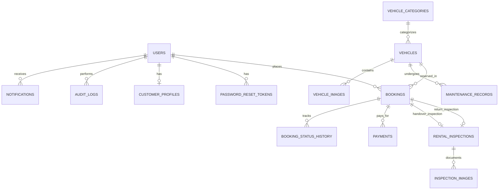

# RideFlow – Web-Based Vehicle Rental Management System

Comprehensive technical design, database architecture, folder structure, and phased implementation plan for **RideFlow**, a production-grade, web-based vehicle rental management platform tailored for university viva evaluation and commercial readiness.

---

## 1. Current Project Analysis

- **Workspace State**: The project root directory `c:\Users\awala\Desktop\vehical rental system` is currently empty.
- **Runtime Environment**:
  - **Java**: Oracle JDK 21 (`21.0.6`) installed at `C:\Program Files\Java\jdk-21`. Backwards-compatible with Java 17; perfect for modern Spring Boot 3.3.x.
  - **Maven**: Apache Maven 3.9.9 installed at `C:\Program Files\apache-maven-3.9.9`.
  - **Node.js**: `v22.14.0` and `npm` 10.9.2 installed and ready.
  - **Database**: MySQL Server 8.0 running as a Windows service (`SmartCartMySQL` on port `3306`), accessible with root credentials (`root`/`root`). MySQL Workbench 8.0 CE is installed for inspection.

---

## 2. Missing-Function List (Scope to Build)

All components must be constructed from the ground up:
1. **Database Schema & Seed Data**:
   - 14 relational tables with full PKs, FKs, unique constraints, and indexes.
   - SQL schema creation script (`schema.sql`) and sample data script (`data.sql`) with Sri Lankan vehicles (Cars, Vans, Bikes), customers, bookings, and realistic LKR rates.
2. **Spring Boot Backend**:
   - Clean layered architecture: `config`, `controller`, `dto`, `entity`, `enum`, `exception`, `mapper`, `repository`, `security`, `service`, `specification`, `util`.
   - Spring Security 6 with stateless JWT authentication, BCrypt hashing, and role-based authorization (`ROLE_CUSTOMER`, `ROLE_STAFF`, `ROLE_ADMIN`).
   - Global exception handling (`@RestControllerAdvice`) returning standardized JSON response format `ApiResponse<T>`.
   - Accurate business logic: backend price calculation ($Total = Days \times Rate + Charges$), availability query preventing overlapping bookings for `PENDING`, `CONFIRMED`, or `ACTIVE` states.
   - Comprehensive audit logging and in-system notifications for every key event.
   - Image upload support (vehicle photos, driving licence, handover/return inspections).
3. **Frontend Web Application**:
   - Modern React + Vite + Tailwind CSS / Vanilla CSS design system (Dark navy `#0f172a`, ocean blue `#2563eb`, sleek slate cards, glassmorphism, responsive grid).
   - React Router DOM v6 with protected routes and role-based redirects (`/admin/*`, `/staff/*`, `/customer/*`).
   - Axios instance with JWT interceptors (auto-attach Bearer token, handle 401/403).
   - Lucide React icons, Toast notifications, modal confirmation dialogs.
   - 17 complete, responsive pages with zero static dummy buttons or mock data.

---

## 3. Database Design

### Relational Entity-Relationship (ER) Model



### Table Definitions & Constraints

1. **`users`**:
   - `id` BIGINT AUTO_INCREMENT PRIMARY KEY
   - `email` VARCHAR(120) NOT NULL UNIQUE
   - `password_hash` VARCHAR(255) NOT NULL
   - `full_name` VARCHAR(100) NOT NULL
   - `phone_number` VARCHAR(20) NOT NULL
   - `role` ENUM('ADMIN', 'STAFF', 'CUSTOMER') NOT NULL
   - `is_active` BOOLEAN DEFAULT TRUE
   - `created_at`, `updated_at` TIMESTAMP DEFAULT CURRENT_TIMESTAMP

2. **`customer_profiles`**:
   - `id` BIGINT AUTO_INCREMENT PRIMARY KEY
   - `user_id` BIGINT NOT NULL UNIQUE (FK -> users.id)
   - `nic_or_passport` VARCHAR(30) NOT NULL
   - `licence_number` VARCHAR(30) NOT NULL
   - `licence_expiry_date` DATE NOT NULL
   - `licence_image_url` VARCHAR(255)
   - `address` VARCHAR(255)
   - `city` VARCHAR(50)

3. **`vehicle_categories`**:
   - `id` BIGINT AUTO_INCREMENT PRIMARY KEY
   - `name` ENUM('CAR', 'VAN', 'BIKE') NOT NULL UNIQUE
   - `description` VARCHAR(255)
   - `base_deposit` DECIMAL(10,2) DEFAULT 0.00

4. **`vehicles`**:
   - `id` BIGINT AUTO_INCREMENT PRIMARY KEY
   - `category_id` BIGINT NOT NULL (FK -> vehicle_categories.id)
   - `registration_number` VARCHAR(20) NOT NULL UNIQUE
   - `make` VARCHAR(50) NOT NULL (e.g. Toyota, Honda, Nissan)
   - `model` VARCHAR(50) NOT NULL (e.g. Prius, Axio, KDH, PCX)
   - `year` INT NOT NULL
   - `colour` VARCHAR(30) NOT NULL
   - `seats` INT NOT NULL
   - `transmission` ENUM('AUTOMATIC', 'MANUAL') NOT NULL
   - `fuel_type` ENUM('PETROL', 'DIESEL', 'HYBRID', 'ELECTRIC') NOT NULL
   - `daily_rate` DECIMAL(10,2) NOT NULL (in LKR)
   - `current_mileage` INT NOT NULL DEFAULT 0
   - `status` ENUM('AVAILABLE', 'RESERVED', 'RENTED', 'MAINTENANCE', 'INACTIVE') NOT NULL DEFAULT 'AVAILABLE'
   - `description` TEXT
   - `primary_image_url` VARCHAR(255)
   - `created_at`, `updated_at` TIMESTAMP

5. **`vehicle_images`**:
   - `id` BIGINT AUTO_INCREMENT PRIMARY KEY
   - `vehicle_id` BIGINT NOT NULL (FK -> vehicles.id ON DELETE CASCADE)
   - `image_url` VARCHAR(255) NOT NULL
   - `is_primary` BOOLEAN DEFAULT FALSE

6. **`bookings`**:
   - `id` BIGINT AUTO_INCREMENT PRIMARY KEY
   - `booking_reference` VARCHAR(30) NOT NULL UNIQUE (e.g. `RF-2026-0001`)
   - `customer_id` BIGINT NOT NULL (FK -> users.id)
   - `vehicle_id` BIGINT NOT NULL (FK -> vehicles.id)
   - `pickup_date` DATE NOT NULL
   - `return_date` DATE NOT NULL
   - `rental_days` INT NOT NULL
   - `daily_rate` DECIMAL(10,2) NOT NULL
   - `rental_subtotal` DECIMAL(10,2) NOT NULL
   - `late_charges` DECIMAL(10,2) DEFAULT 0.00
   - `damage_charges` DECIMAL(10,2) DEFAULT 0.00
   - `additional_charges` DECIMAL(10,2) DEFAULT 0.00
   - `final_total` DECIMAL(10,2) NOT NULL
   - `status` ENUM('PENDING', 'CONFIRMED', 'REJECTED', 'ACTIVE', 'COMPLETED', 'CANCELLED') NOT NULL DEFAULT 'PENDING'
   - `notes` TEXT
   - `created_at`, `updated_at` TIMESTAMP

7. **`booking_status_history`**:
   - `id` BIGINT AUTO_INCREMENT PRIMARY KEY
   - `booking_id` BIGINT NOT NULL (FK -> bookings.id ON DELETE CASCADE)
   - `from_status` VARCHAR(20)
   - `to_status` VARCHAR(20) NOT NULL
   - `changed_by_user_id` BIGINT NOT NULL (FK -> users.id)
   - `reason` VARCHAR(255)
   - `created_at` TIMESTAMP DEFAULT CURRENT_TIMESTAMP

8. **`payments`**:
   - `id` BIGINT AUTO_INCREMENT PRIMARY KEY
   - `booking_id` BIGINT NOT NULL (FK -> bookings.id)
   - `payment_method` ENUM('CASH', 'CARD', 'BANK_TRANSFER') NOT NULL
   - `amount` DECIMAL(10,2) NOT NULL
   - `payment_status` ENUM('PENDING', 'PAID', 'PARTIALLY_PAID', 'REFUNDED') NOT NULL
   - `reference_number` VARCHAR(50) NOT NULL UNIQUE
   - `payment_date` TIMESTAMP DEFAULT CURRENT_TIMESTAMP
   - `recorded_by_user_id` BIGINT NOT NULL (FK -> users.id)
   - `notes` TEXT

9. **`rental_inspections`**:
   - `id` BIGINT AUTO_INCREMENT PRIMARY KEY
   - `booking_id` BIGINT NOT NULL (FK -> bookings.id)
   - `type` ENUM('HANDOVER', 'RETURN') NOT NULL
   - `inspection_datetime` TIMESTAMP DEFAULT CURRENT_TIMESTAMP
   - `mileage` INT NOT NULL
   - `fuel_level` ENUM('EMPTY', 'QUARTER', 'HALF', 'THREE_QUARTERS', 'FULL') NOT NULL
   - `damage_notes` TEXT
   - `checklist_json` TEXT (exterior, lights, tyres, spare wheel, documents)
   - `late_charges` DECIMAL(10,2) DEFAULT 0.00
   - `damage_charges` DECIMAL(10,2) DEFAULT 0.00
   - `fuel_charges` DECIMAL(10,2) DEFAULT 0.00
   - `other_charges` DECIMAL(10,2) DEFAULT 0.00
   - `total_charges` DECIMAL(10,2) DEFAULT 0.00
   - `inspected_by_user_id` BIGINT NOT NULL (FK -> users.id)
   - `customer_acknowledged` BOOLEAN DEFAULT TRUE

10. **`inspection_images`**:
    - `id` BIGINT AUTO_INCREMENT PRIMARY KEY
    - `inspection_id` BIGINT NOT NULL (FK -> rental_inspections.id ON DELETE CASCADE)
    - `image_url` VARCHAR(255) NOT NULL

11. **`maintenance_records`**:
    - `id` BIGINT AUTO_INCREMENT PRIMARY KEY
    - `vehicle_id` BIGINT NOT NULL (FK -> vehicles.id)
    - `maintenance_type` VARCHAR(50) NOT NULL (e.g. Engine Oil Service, Brake Pad Replacement)
    - `start_date` DATE NOT NULL
    - `expected_completion_date` DATE NOT NULL
    - `actual_completion_date` DATE
    - `cost` DECIMAL(10,2) NOT NULL DEFAULT 0.00
    - `service_provider` VARCHAR(100) NOT NULL (e.g. Toyota Lanka, AMW)
    - `notes` TEXT
    - `status` ENUM('SCHEDULED', 'IN_PROGRESS', 'COMPLETED', 'CANCELLED') NOT NULL DEFAULT 'SCHEDULED'
    - `created_at`, `updated_at` TIMESTAMP

12. **`notifications`**:
    - `id` BIGINT AUTO_INCREMENT PRIMARY KEY
    - `user_id` BIGINT NOT NULL (FK -> users.id)
    - `title` VARCHAR(100) NOT NULL
    - `message` TEXT NOT NULL
    - `type` VARCHAR(50) NOT NULL
    - `is_read` BOOLEAN DEFAULT FALSE
    - `created_at` TIMESTAMP DEFAULT CURRENT_TIMESTAMP

13. **`audit_logs`**:
    - `id` BIGINT AUTO_INCREMENT PRIMARY KEY
    - `user_id` BIGINT (FK -> users.id, nullable for anonymous/failed login)
    - `action` VARCHAR(50) NOT NULL
    - `entity_type` VARCHAR(50) NOT NULL
    - `entity_id` VARCHAR(50)
    - `old_value` TEXT
    - `new_value` TEXT
    - `ip_address` VARCHAR(45)
    - `created_at` TIMESTAMP DEFAULT CURRENT_TIMESTAMP

14. **`password_reset_tokens`**:
    - `id` BIGINT AUTO_INCREMENT PRIMARY KEY
    - `user_id` BIGINT NOT NULL (FK -> users.id)
    - `token` VARCHAR(100) NOT NULL UNIQUE
    - `expiry_date` TIMESTAMP NOT NULL
    - `used` BOOLEAN DEFAULT FALSE

---

## 4. Final Folder Structure

```
c:\Users\awala\Desktop\vehical rental system\
├── backend/
│   ├── pom.xml
│   ├── src/
│   │   ├── main/
│   │   │   ├── java/com/rideflow/
│   │   │   │   ├── RideFlowApplication.java
│   │   │   │   ├── config/             # SecurityConfig, WebConfig, CorsConfig, OpenApiConfig
│   │   │   │   ├── controller/         # Auth, User, Vehicle, Booking, Inspection, etc.
│   │   │   │   ├── dto/                # Request and Response DTOs
│   │   │   │   ├── entity/             # JPA Entities
│   │   │   │   ├── enum/               # Enums (Role, BookingStatus, VehicleStatus, etc.)
│   │   │   │   ├── exception/          # GlobalExceptionHandler, Custom Exceptions
│   │   │   │   ├── mapper/             # Entity <-> DTO Mappers
│   │   │   │   ├── repository/         # Spring Data JPA Repositories
│   │   │   │   ├── security/           # JwtTokenProvider, JwtAuthFilter, CustomUserDetailsService
│   │   │   │   ├── service/            # Core Business Services & Implementation
│   │   │   │   ├── specification/      # VehicleSpecification for dynamic filtering
│   │   │   │   └── util/               # FileStorageService, DateUtils, PriceCalculator
│   │   │   └── resources/
│   │   │       ├── application.properties
│   │   │       ├── schema.sql
│   │   │       └── data.sql
│   │   └── test/java/com/rideflow/     # Integration and Unit Tests
│   └── uploads/                        # Stored vehicle, licence, and inspection images
├── frontend/
│   ├── index.html
│   ├── package.json
│   ├── vite.config.js
│   ├── tailwind.config.js
│   ├── postcss.config.js
│   └── src/
│       ├── assets/                     # Logos, illustrations
│       ├── components/                 # Navbar, Sidebar, VehicleCard, DataTable, StatusBadge, etc.
│       ├── context/                    # AuthContext, NotificationContext
│       ├── hooks/                      # useAuth, useDebounce, etc.
│       ├── layouts/                    # MainLayout, DashboardLayout, AuthLayout
│       ├── pages/                      # 17 pages (Home, Catalogue, Booking, Dashboards, etc.)
│       ├── routes/                     # AppRoutes, ProtectedRoute
│       ├── services/                   # Axios API services (auth, vehicle, booking, etc.)
│       ├── utils/                      # formatters (LKR, dates), validation helpers
│       ├── App.jsx
│       ├── main.jsx
│       └── index.css
├── database/
│   ├── schema.sql                      # Complete MySQL Workbench DDL
│   └── seed-data.sql                   # Realistic Sri Lankan sample data
└── docs/
    ├── README.md
    ├── API_DOCUMENTATION.md
    ├── ER_DIAGRAM.md
    └── UML_DIAGRAMS.md
```

---

## 5. Phased Implementation Plan

### Phase 1 – Foundation & Database Setup
- Initialize Spring Boot 3.3.x backend project with Maven (`pom.xml`).
- Create MySQL database `rideflow_db` on port 3306.
- Write `schema.sql` and `seed-data.sql` and execute against MySQL.
- Configure `application.properties` with database credentials and JWT secret.
- Initialize React + Vite frontend project with Tailwind CSS, Lucide React, Axios, React Router.
- Verify end-to-end communication with a `/api/health` test endpoint.

### Phase 2 – Authentication & Security System
- Implement User & Profile JPA entities, repositories, and password hashing (BCrypt).
- Implement JWT token generator, validation, and filter.
- Implement `/api/auth/register`, `/api/auth/login`, `/api/auth/profile`, `/api/auth/forgot-password`, `/api/auth/reset-password`.
- Pre-seed default BCrypt accounts:
  - Admin: `admin@rideflow.lk` / `Admin123!`
  - Staff: `staff@rideflow.lk` / `Staff123!`
  - Customer: `customer@rideflow.lk` / `Customer123!`
- Frontend: AuthContext, persistent JWT in local storage / session, Axios auth interceptor, Login, Register, Forgot Password, Profile, Licence upload pages, and ProtectedRoute by role.

### Phase 3 – Vehicle & Category Management
- Implement Vehicle & VehicleCategory entities, specifications, and repositories.
- Implement VehicleService and Controller: full CRUD, image upload handling, status changes.
- Availability query logic with JPA Specifications for filtering by category, price range, transmission, fuel, seats.
- Frontend: Vehicle Catalogue, Vehicle Details modal/page, Admin Vehicle Management (Add/Edit/Deactivate/Upload images), Category manager.

### Phase 4 – Availability Engine & Booking Workflow
- Implement Booking entity, repository, and service.
- Strict availability verification: check if vehicle has any overlapping bookings with status in `(PENDING, CONFIRMED, ACTIVE)`.
- Backend price calculation: rental days $\times$ daily rate, zero client-trust pricing.
- Booking endpoints: Create booking, list customer bookings, view booking details, cancel eligible pending/confirmed booking.
- In-system notification and audit log generation upon booking events.
- Frontend: Booking Form with dynamic date picker, real-time price preview, Customer My Bookings list, Booking Details page.

### Phase 5 – Staff Operations (Verification, Handover & Return)
- Staff endpoints:
  - List pending bookings for review; Approve (Confirmed) or Reject with reason.
  - Handover inspection: Record mileage, fuel level, initial damages, checklist, start rental $\rightarrow$ status `ACTIVE`, vehicle status $\rightarrow$ `RENTED`.
  - Return inspection: Record return mileage, fuel level, damage/late charges, complete rental $\rightarrow$ status `COMPLETED`, vehicle status $\rightarrow$ `AVAILABLE`.
- Frontend: Staff Booking Queue, Handover Inspection Form, Return & Settlement Form.

### Phase 6 – Payments & Maintenance Management
- Payment records: Cash, Card, Bank Transfer with reference numbers and staff attribution.
- Maintenance management: Schedule maintenance, start maintenance (vehicle $\rightarrow$ `MAINTENANCE`), complete maintenance (vehicle $\rightarrow$ `AVAILABLE`).
- Frontend: Payment logging modal/page, Maintenance scheduling & history table.

### Phase 7 – Dashboards & Reporting
- Custom analytical endpoints for Admin, Staff, and Customer dashboards (KPI counts, monthly revenue, vehicle category breakdown, recent activity).
- Frontend:
  - Admin Dashboard with metrics cards, recent bookings table, fleet status donut/bar charts.
  - Staff Dashboard with today's handovers/returns, pending verifications.
  - Customer Dashboard with upcoming bookings, active rental badge, and quick actions.

### Phase 8 – Audit Logs, Notifications, Testing & Documentation
- Audit log viewer for Admin.
- In-app notification center with read/unread toggle.
- Unit & integration tests for backend (Authentication, Booking price calculation, Double-booking prevention).
- Complete documentation: `README.md`, `API_DOCUMENTATION.md`, MySQL setup guide, ER diagrams, and UML activity diagrams.

---

## 6. Verification Plan

### Automated Verification
- Maven build & tests:
  ```powershell
  $env:JAVA_HOME="C:\Program Files\Java\jdk-21"; mvn clean test -Dtest=RideFlowApplicationTests
  ```
- Backend REST API test suite via curl/PowerShell:
  - Login as Admin, Staff, Customer.
  - Search available vehicles for specific dates.
  - Create booking $\rightarrow$ verify calculated total and pending status.
  - Attempt conflicting booking for same dates $\rightarrow$ assert 400 Conflict response.
  - Staff approve $\rightarrow$ Handover $\rightarrow$ Return lifecycle test.
- Frontend build check:
  ```powershell
  npm run build
  ```

### Browser & UI Verification
- Using Browser Subagent:
  1. Open `http://localhost:5173`.
  2. Test Customer registration and login.
  3. Browse catalogue, filter by 'SUV/Car', check availability for tomorrow to 3 days later.
  4. Complete booking form and view confirmation.
  5. Login as Staff (`staff@rideflow.lk`), confirm booking, execute Handover inspection.
  6. Execute Return inspection with minor extra charge and complete rental.
  7. Login as Admin (`admin@rideflow.lk`), view updated revenue metrics on dashboard.
